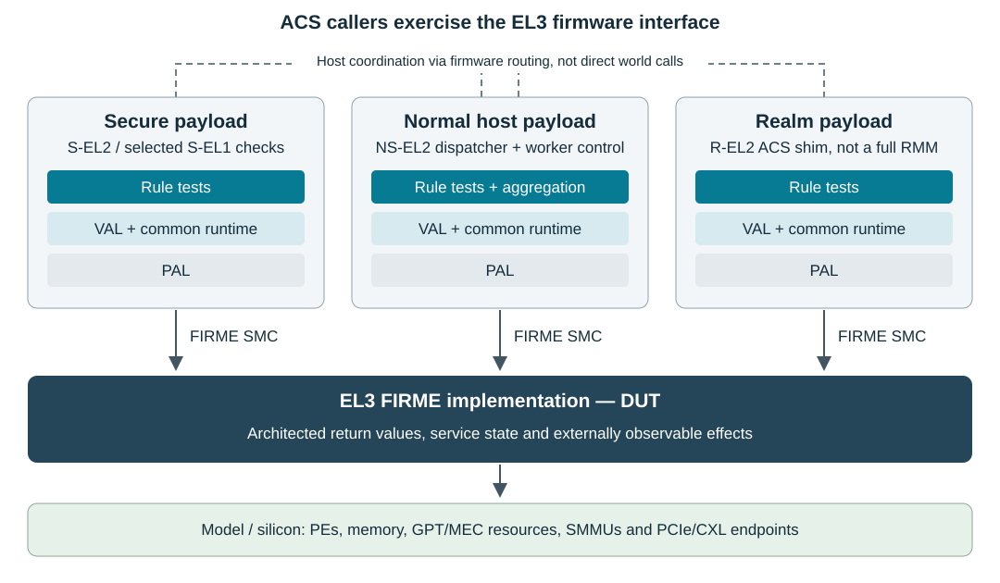
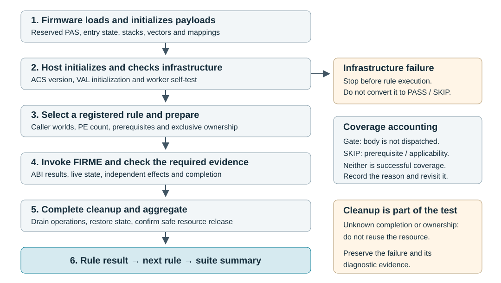

================================================================================
Arm® FIRME A-profile Architecture Compliance Suite Validation Methodology
================================================================================

Copyright © 2026 Arm Limited (or its affiliates). All rights reserved.

.. contents:: Contents
   :depth: 2

Document status
===============

This working draft describes the validation methodology for FIRME-ACS
``v26.10_FIRME_1.0.1`` (v1.0.1 Alpha), aligned with DEN0149 FIRME 1.0 ALP4.
Release quality is **Alpha (qualification incomplete)**. The README records
`known results and limitations <../README.md#release-quality-and-known-results>`_;
registration and completed execution do not establish full compliance.

This source replaces the repository's v0.5 Alpha PDF. Publication history
and the retained `Proprietary Notice`_ are provided at the end of this document.

For current build instructions, use the `FIRME-ACS README <../README.md>`_.
For individual rule algorithms, registration state and coverage limitations,
use the `scenario document
<FIRME_Architecture_Compliance_Suite_Scenario_Document.rst>`_. This methodology
explains how evidence is obtained; it does not replace either document.

Overview
========

FIRME and the purpose of the ACS
--------------------------------

Firmware Interfaces for RME (FIRME) defines interfaces through which software
requests services from EL3 firmware. These services support operations such as
Granule Protection Table (GPT) management, Memory Encryption Context (MEC)
refresh and Integrity and Data Encryption (IDE) key management. The wider
specification also defines attestation and integrated-device services.

RME supplies architectural mechanisms for separating physical address spaces
and enforcing access permissions. FIRME specifies the firmware interfaces
that manage the associated resources. FIRME-ACS exercises those interfaces
and checks their externally observable behavior against the specification.
It does not replace hardware architecture compliance testing, an RMM
implementation, or a complete security evaluation of the platform.

The Design Under Test (DUT) is the EL3 FIRME implementation. It can be supplied
by any firmware implementer. Trusted Firmware-A (TF-A) is the reference
firmware used by the supplied FVP integration, not a requirement imposed on
every partner implementation.

Scope and evidence
------------------

The Alpha1 scope comprises Concepts/Base, Granule Management, MECID
Management, IDE Key Management, and the ABI-interface rules associated with
those services. Tests retain individual rule identities even when several
rules share an ABI adapter or common helper. An interface-rule test does not
replace the service-specific tests for state changes and error conditions.

Attestation and Integrated Device Management are not included as complete
Alpha1 service suites. Some shared-buffer Concepts rules need an applicable
ABI from those services to obtain meaningful evidence. Such tests require a
qualified service adapter; the absence of one is a coverage limitation, not
a successful validation of the rule.

The ACS distinguishes three kinds of evidence:

* **DUT observations:** actual ABI results, prescribed register behavior,
  access effects, operation completion, and independently observed state.
* **ACS infrastructure checks:** native unit checks, generated-catalog
  consistency checks and worker self-tests. These help establish harness
  correctness but do not establish compliance with a FIRME rule by themselves.
* **Unavailable evidence:** an unimplemented adapter, an unqualified fixture,
  a missing platform capability or an unresolved DUT defect. These must remain
  visible in coverage accounting and release qualification.

An expected result comes from the selected specification revision, not from
what the reference firmware currently returns. Feature discovery determines
whether a scenario is applicable; it must not waive a mandatory requirement.
Strict tests and their failures remain visible, with missing evidence
distinguished from a DUT mismatch. R0023 and R0041 have Architect-agreed
exclusions documented in the scenario document.

Abbreviations
-------------

.. list-table:: Terms used in this document
   :header-rows: 1
   :widths: 20 80

   * - Term
     - Meaning
   * - ABI / ACS
     - Application Binary Interface / Architecture Compliance Suite
   * - DUT / FVP
     - Design Under Test / Fixed Virtual Platform
   * - GPC / GPI / GPT
     - Granule Protection Check / Granule Protection Index / Granule Protection Table
   * - IDE / MEC
     - Integrity and Data Encryption / Memory Encryption Context
   * - MP / PE
     - Multiprocessor / Processing Element
   * - NS / PA / PAS
     - Non-secure / Physical Address / Physical Address Space
   * - PAL / VAL
     - Platform Abstraction Layer / Validation Abstraction Layer
   * - PoC / PoE / PoPA
     - Point of Coherency / Point of Encryption / Point of Physical Aliasing
   * - RMM / RME
     - Realm Management Monitor / Realm Management Extension
   * - SBZ / SMC / SMCCC
     - Should Be Zero / Secure Monitor Call / SMC Calling Convention
   * - SME / SVE
     - Scalable Matrix Extension / Scalable Vector Extension
   * - SPDM / DOE / ECAM
     - Security Protocol and Data Model / Data Object Exchange / Enhanced Configuration Access Mechanism

ACS architecture and DUT boundary
=================================

   Caller payloads, common software layers and the EL3 DUT boundary.

Software layers
---------------

* **Tests** define the preconditions, invocations, expected results and cleanup
  for individual rules. Test names describe behavior; rule IDs provide
  traceability to the selected specification revision.
* **VAL** provides suite dispatch, FIRME wrappers, ABI execution, cross-world
  transport, PE coordination, resource ownership and common validation helpers.
* **Common runtime** provides bare-metal entry, exception handling, SMCCC
  assembly, logging, memory operations and MMU support shared by the images.
* **PAL** supplies genuine platform information and access mechanisms: memory
  reservations, PE affinities, SMMU locations, UART/GIC bases and PCIe windows.
  An optional observation hook must obtain independent evidence; it must not
  manufacture the expected answer from the DUT's return value.

Components
----------

.. list-table:: Execution components and responsibilities
   :header-rows: 1
   :widths: 24 76

   * - Component
     - Description
   * - NS-EL2 host payload
     - Coordinates execution, runs Normal-world checks, requests other-world
       work, manages worker PEs and produces the aggregate test report.
   * - Secure payload
     - Runs Secure-world checks at S-EL2, with a controlled S-EL1 entry path
       for scenarios that need it. It returns test results to the host.
   * - Realm payload
     - Runs Realm-world checks at R-EL2 and provides the required test-side
       coordination. It is an ACS payload, not a complete RMM implementation.
   * - EL3 firmware (DUT)
     - Implements the FIRME ABIs and the services they control. Boot and
       cross-world routing also depend on the firmware integration.
   * - Model or silicon platform
     - Supplies PEs, memory, access enforcement and any required SMMU,
       PCIe/CXL endpoints or encryption resources.

In the reference TF-A integration, BL32, BL33 and the Realm payload slot load
the three images. SPMD/RMMD route cross-world requests; these mechanisms are
integration details, not the source of architectural expected results.

Source directory structure
--------------------------

The suite is organized under ``cca/firme/``::

    cca/firme/
    ├── CMakeLists.txt
    ├── README.md
    ├── docs/                         Methodology, scenarios and integration guides
    ├── ext/                          Pinned libspdm and spdm-emu dependencies
    ├── platform/pal_baremetal/targets/
    │   └── fvp/
    │       ├── include/              Platform configuration and contracts
    │       └── src/                  Platform access and fixture implementations
    ├── val/
    │   ├── host/                     NS host and worker orchestration
    │   ├── secure/                   Secure payload
    │   ├── realm/                    R-EL2 payload
    │   ├── include/                  Common VAL interfaces
    │   └── src/                      FIRME wrappers, suite and shared helpers
    ├── val_common/
    │   ├── include/                  Bare-metal runtime interfaces
    │   └── src/                      SMCCC, vectors, MMU, logging and memory
    ├── test/
    │   └── <module>/                 Handwritten and generated rule tests
    └── tools/
        ├── cmake/                    Compiler toolchains and build integration
        ├── config/                   ABI catalog, manifests and model configuration
        ├── linker/                   Payload linker scripts
        └── scripts/                  Build, run, generation and audit tools

Boot and execution flow
=======================

   Boot-to-report flow. Missing evidence must not become a passing result.

Boot preparation
----------------

1. Firmware initializes the platform and loads the ACS images into their
   reserved address ranges and security states.
2. Each payload's cold entry establishes its stack and exception vectors,
   clears its own BSS once and initializes the execution environment. The NS
   and Realm payloads construct their identity mappings and enable the MMU.
   The reference Secure payload normally runs with its MMU disabled.
3. Secure and Realm payloads become available for routed test requests. The
   firmware integration determines their initialization order; FIRME itself
   does not mandate the reference loader's sequence.
4. The NS host prints the ACS version, initializes VAL and checks the worker
   infrastructure. With the default MP self-test enabled, an infrastructure
   failure stops the run before rule execution rather than producing a rule
   PASS or SKIP.
5. The host enumerates the compiled suite registry. A default ``SUITE=all``
   build includes every selected module's registered tests; a module-specific
   build restricts that set.

Rule execution
--------------

1. Select the rule's registered entry, required and optional caller worlds,
   and any PE-count requirement. Obtain prerequisites without altering the
   expected outcome to match the DUT.
2. Reserve the memory, device path or operation state needed by the scenario.
   Establish and check valid setup before testing the intended condition.
3. Run the applicable caller-world bodies. Ordinary dispatch uses Secure,
   Realm and Normal checks as declared by the entry. The caller issues the
   real FIRME SMC; cross-world messaging only transports the test request and
   its result.
4. Check the architected return fields and the independent effects required
   by the rule. Continue long-running operations using their actual returned
   state, with bounded retries and the specified terminal conditions.
5. Drain outstanding operations, restore modified state and release only
   resources whose ownership and safe cleanup are confirmed. Cleanup failure
   is a failure even if the earlier ABI checks passed.
6. Aggregate the world results and any rule-level post-check, then print one
   rule outcome. Missing required-world coverage cannot be hidden by a
   passing Normal-world check.

Cross-world results are matched to the requesting execution and PE. The rule
outcome, failure step and captured DUT registers remain separate from
transport success. After suite cleanup, the host requests platform shutdown;
an abnormal exit remains an execution error even after a complete UART summary.

Common ABI test framework
=========================

The framework uses a reviewed ABI catalog and per-ABI scenario descriptions
to generate one-rule test entry points and registry fragments. Its execution
frame contains ``x0`` through ``x17`` so that input, output and preservation
checks are not restricted to a convenience wrapper's smaller result structure.
The catalog assigns meaning to registers per ABI; it does not make every
register an input or valid output of every invocation.

For each ABI, a handwritten adapter supplies valid state and inputs,
rule-specific mutations, output and effect validation, and cleanup. The
generated runner applies the cases and aggregates their results. Negative
cases isolate the intended invalid condition; outputs are interpreted only
when the specification defines them for the returned status.

Host coordinates owned GPT and IDE fixtures for remote callers. A sequenced
command channel transfers the complete register frame to the Secure or Realm
payload, which executes the SMC in that security state. Discovery, setup,
test invocation and cleanup use the same caller world. Lost acknowledgements
do not cause a second SMC; an uncertain result quarantines the resources.

Generated sources are checked into the suite and built normally; running the
generator does not temporarily activate tests. Registry and evidence limits
remain visible in coverage accounting. See
`ABI test generation <../tools/config/abi/README.md>`_ and
`Alpha1 ABI interface coverage <FIRME_Alpha1_ABI_Interface_Coverage.md>`_.

SMCCC and Concepts rules retain their own tests. There is no implicit
requirement to execute those tests before an ABI-interface test, and sharing
helpers does not combine separate rule results. Static caller audits assess
the ACS callers within their declared scope; they do not demonstrate that
every possible external caller handles unused outputs correctly.

Service validation methods
==========================

Concepts and Base service
-------------------------

Tests invoke ``FIRME_SERVICE_VERSION`` and ``FIRME_SERVICE_FEATURES`` from the
applicable caller instances and check discovery, feature-register contents,
version rules and ABI availability against the specification. Where a rule
requires ``NOT_SUPPORTED``, an unrelated negative error is not equivalent.
Service-list membership, feature bits and version responses are checked for
the consistency required by the relevant rule.

SMCCC scenarios check applicable register and live SVE/SME state behavior,
not just an advertised SMCCC version or unchanged return status. SVE hints
affect which state must remain live; they do not waive FIRME SBZ input
requirements. Any unavailable state probe or unsupported observation remains
an explicit coverage limitation.

Shared-buffer rules require an applicable service invocation and evidence of
the tested address, size and ownership. R0070 requires independent EL3 mapping
attribute evidence; R0071 requires evidence of the buffer's PAS/GPI. ABI
success alone does not prove either. EL3 mapping lifetime is informational
I0073 and does not require a separate test. An unavailable observation remains
a coverage limitation, not an implied exclusion of R0070 or R0071.

Granule Management
------------------

GPT tests operate only on exclusively reserved, backed memory. They establish
the source GPI and caller access conditions before requesting a transition,
then check the required status, completed-granule count, continuation behavior
and effects. Setup and restoration are part of the test contract; a rejected
setup operation cannot be silently treated as successful initialization.

Where applicable, accesses from different security states provide independent
evidence of the new access permissions. The expected fault syndrome must be
checked so that an unrelated translation or alignment fault cannot pass a GPC
test. Access probes alone do not establish internal bridge-object lifetime,
scrubbing order, or every protected-range management property.

NS and NSO are distinguished by a Secure access selecting Non-secure output
PAS: NS permits that access, whereas NSO rejects it with a granule protection
fault.

L1 creation and destruction need a suitable protected range and separately
reserved object storage. The table object's architected size is distinct
from the size of the complete granules that contain it. Tests that require
retained operations, resource exhaustion, bridge reclamation or complete
scrubbing need a deterministic fixture and independent observation of those
conditions. An address constant and an ABI ``SUCCESS`` response are not a
replacement for that evidence.

Concurrent scenarios require operations that genuinely overlap and exercise
the state named by the rule. Merely running the same call on multiple PEs, or
changing a GPI when the observed protected-range state is unchanged, does not
prove a concurrency requirement. An unavailable fixture remains an explicit
runtime evidence limitation, not successful concurrency validation.

MECID Management
----------------

Common-width validation obtains hardware evidence from every configured PE
and every platform-listed SMMU. Realm execution reads the PE MECID register;
SMMU capability and MECID registers supply the corresponding requester data.
The test decodes the field encodings, calculates the system minimum and checks
the DUT-advertised common width and applicable MECID boundaries. The boot PE's
width alone is not the system minimum on a heterogeneous platform.

The platform inventory must be complete. A missing or inaccessible requester
cannot simply be omitted to make the advertised minimum match. An out-of-range
MECID scenario is applicable only when such a value can be represented in the
architected input field; an impossible encoding is not fabricated by using
unrelated unused bits.

Refresh validation can use an indirect memory observation without reading raw
ciphertext:

1. Establish the old context for a disposable MECID and write known plaintext
   to an exclusively owned physical address using that context.
2. Complete the required cache maintenance so the subsequent observation
   cannot be satisfied from cached old plaintext. Quiesce other users of the
   MECID and use the same address throughout the comparison.
3. Invoke ``FIRME_MEC_REFRESH`` and follow the specified completion protocol.
4. Read the old protected data using the refreshed context. A completed read
   must not reproduce the old plaintext for the decorrelation check.
5. Write and read the known plaintext using the new context, including the
   required maintenance, to establish that the new-context memory path works.
6. Restore the execution state and release the test resource safely.

A mismatching completed read is indirect evidence; it is not a sample of the
ciphertext bits. An integrity abort is a different observation and must not
automatically pass a strict ciphertext-decorrelation rule. Its treatment
requires the rule's specified evidence or an explicit architectural agreement.
A successful new-context round trip prevents a broken memory path from being
mistaken for decorrelation.

The optional reference-model refresh extension is a functional experiment.
It can qualify sequencing and modeled effects, not cryptographic strength,
and does not change the test's architectural expectations.

IDE Key Management
------------------

VAL discovers the PCIe topology and capabilities through the platform's ECAM
access, selects an available path and reserves the resources needed by the
test. PAL supplies access information and genuine ownership restrictions,
not a presumed supply of arbitrary Stream IDs. A configured or locked stream
is not free merely because it is disabled.

Selective IDE ABI scenarios provision unused Root Port and endpoint stream
blocks on an ACS-owned path. They check the required PROG, GO, STOP and POLL
behavior, handles, completion and cleanup. The inactive Selective stream
fixture does not itself establish an authenticated endpoint session or prove
protected end-to-end traffic.

The CXL.cachemem experiment uses a Type-2 endpoint with an SPDM/DOE session.
The ACS coordinates endpoint key programming through that session; Root Port
key programming remains the responsibility of the EL3 service invoked through
FIRME. Matching key and direction state, completion, traffic effects, and
cleanup at both ends are separate checks. Writing Root Port keys directly
instead of invoking FIRME would bypass the behavior under test.

The experimental paired backend provides transaction-level CXL.mem evidence,
not complete CXL.cache, wire-protocol or cryptographic qualification. It needs
matching firmware, model and endpoint configuration; ``SUITE=ide`` alone does
not supply them. See `IDE validation setup <IDE_Validation_Setup.md>`_.

Cleanup must retain ownership until pending responses are drained and both
ends are stopped or otherwise safely restored. A timeout, unknown handle
ownership or failed cleanup must prevent resource reuse. Namespace tests
require independently observable paths. The paired backend checks same-ECAM
RX/TX isolation; two-ECAM fixture work remains deferred, not waived.

Memory, mappings and exceptions
===============================

Payload reservations
--------------------

The reference linker scripts in ``tools/linker/`` define the following image
reservations. These are integration defaults, not architectural addresses.

.. list-table:: Reference FVP payload layout
   :header-rows: 1
   :widths: 24 20 14 42

   * - Payload / binary
     - Base address
     - Reservation
     - Use
   * - NS / ``nsel2.bin``
     - ``0x88000000``
     - 2 MiB
     - NS-EL2 host, tests and per-PE stacks
   * - Secure / ``secure.bin``
     - ``0x06000000``
     - 1 MiB
     - Secure shim, tests and per-PE stacks
   * - Realm / ``rel2.bin``
     - ``0xFDC00000``
     - 1 MiB
     - R-EL2 shim, tests, stacks and reserved MEC test page

These are separate PAS reservations, not allocations from one NS heap. The
firmware loader must assign each complete reservation to its intended
security state; payload stacks and test storage must not overlap.

The configured GPT window is separate from the images. It must not overlap
live firmware, payload storage or another agent's memory. Increasing model
DRAM does not automatically reserve that memory for ACS or map it into each
payload. In particular, ``GPT_GPI_ANY`` is not a general allocation state from
which arbitrary GPI transitions may be assumed legal; permitted transitions
must come from the selected FIRME specification.

Translation and attributes
--------------------------

The common runtime maps configured DRAM as Normal WBWA memory and device
regions as Device-nGnRE. Test-specific mappings remain bounded by ownership
and restoration requirements; arbitrary addresses are not necessarily mapped.

All participating PEs must agree on the attributes of shared memory. Mapping
changes must not race with worker accesses; cache and TLB synchronization
requirements remain distinct from the rule-specific PoE/PoPA requirements.
Both GCC and Clang builds retain strict alignment for code that can execute
with the MMU disabled, and use self-contained atomic operations rather than
depending on a hosted runtime.

Expected-fault recovery
-----------------------

Fault probes use a per-PE recovery scope and capture diagnostic state such as
ESR and FAR. The test checks that the observed exception is the one required
by its scenario before treating it as evidence. An arbitrary abort is not
proof of correct access enforcement. A fault outside an expected recovery
scope is a run failure, not a reason to continue with a passing result.

Probe state must be retired before resources are restored or reused. Scoped
recovery does not make all instructions or asynchronous failures recoverable.
An SMC that does not return still requires an external watchdog and an
incomplete-run report; expiry of that watchdog is not a successful test.

Multiprocessor execution
========================

MP-aware tests participate in the normal registry. They specify a fixed PE
count or ``VAL_TEST_ALL_PES`` and supply the setup, payload phases, aggregation
and cleanup required by the rule. An insufficient PE count is reported
explicitly rather than silently reduced. The controller PE is identified by
its actual affinity and need not be index zero in the platform table.

The convenience runner enumerates the chosen PEs serially, including routed
Secure or Realm work. That is sufficient for requester-width collection.
Scenarios that require concurrent activity must explicitly dispatch workers
and synchronize their overlapping operations. Existing rule bodies are not
automatically safe to run in parallel: some S-EL1, vector-state, PCIe/IDE and
audit resources remain serial facilities.

Worker lifecycle and cache ordering
-----------------------------------

1. Publish executable code, translation tables and boot storage to PoC before
   releasing a worker.
2. Use PSCI CPU_ON to start the worker on a private stack with existing shared
   mappings; do not clear shared BSS or rebuild active translation tables.
3. Wait for initialized per-PE state and explicit readiness, not just a
   successful CPU_ON response.
4. Publish requests and results through coherent mailboxes with release/acquire
   ordering; cache maintenance is not a substitute for synchronization.
5. Confirm completion and CPU_OFF before reuse. A timeout or uncertain cleanup
   quarantines the PE and its storage.

The current implementation requires coherent shared Normal memory. It does
not qualify non-coherent platforms. Worker contexts must outlive their jobs;
unconfirmed completion must not be followed by releasing their memory or
running dependent tests. PoC publication for workers does not satisfy MEC
observations that require maintenance to PoE or PoPA.

The worker self-test checks startup, coherent exchanges, failure propagation,
cross-world entry and shutdown before rule execution. It is infrastructure
evidence, not additional rule coverage. Model-based MP qualification requires
modeled caches and a recorded topology; a single PE cannot provide MP evidence.
See `MP execution <MP_Execution.md>`_ for the detailed platform contract and
worker APIs.

Results and coverage accounting
===============================

There are three distinct result layers: the DUT's ABI return status, the
test's ``ACS_STATUS_*`` record, and the VAL function's completion status.
``VAL_SUCCESS`` is not a substitute for an architectural ``SUCCESS`` return
or a rule PASS. A deliberately skipped test can complete normally, but its
record and the final summary must still identify it as skipped. A failed
test must propagate failure rather than returning a misleading successful
completion.

.. list-table:: Interpretation of reported and unexecuted cases
   :header-rows: 1
   :widths: 20 80

   * - Classification
     - Meaning
   * - PASS
     - The executed scenario meets its specified checks, including required
       caller coverage and cleanup. It is not a claim about unexecuted cases.
   * - FAIL / ERR
     - A DUT mismatch, malformed result, required-world failure, unsafe
       cleanup or harness error. Preserve diagnostics to distinguish causes.
   * - SKIP
     - An explicit applicability or prerequisite limitation. It is not
       evidence that the rule passed; a required-world skip prevents PASS.
   * - Registry-gated
     - A test body or plan is intentionally not dispatched. Its reason and
       re-enable condition must remain in the coverage record, outside the
       executed-test total.
   * - Excluded / out of scope
     - An explicit scope decision with rationale and approval status in the
       scenario/release record. Static declarations must not be counted as
       runtime DUT validation in place of such a decision.

The UART report identifies the suite, descriptive test name, rule ID,
per-world checks and aggregate result. Failure diagnostics include the check
step and relevant DUT register values. Transport errors and incomplete runs
must not be collapsed into unsupported-feature skips. Optional-world absence
does not justify ignoring malformed responses from a world that did execute.

An unresolved GPT operation or failed restoration quarantines GPT scratch
storage. The original failure remains; dependent tests skip with the blocking
rule identified, while independent suites continue. An unresponsive secondary
PE stops the run because its outstanding accesses cannot be safely isolated.

A completed process or a zero-failure subtotal alone is insufficient for
release qualification. The run must reach its completion summary, exercise
the intended suite and account for missing, gated and skipped cases. A build
containing all modules can still have incomplete rule coverage.

Partner integration and qualification
=====================================

Platform headers
----------------

The principal target headers are under
``platform/pal_baremetal/targets/<target>/include/``:

.. list-table:: Partner configuration entry points
   :header-rows: 1
   :widths: 40 60

   * - Header
     - Platform information or contract
   * - ``pal_platform.h``
     - Memory windows, granule configuration, UART/GIC and integration defaults
   * - ``pal_pe.h`` and ``pal_iovirt.h``
     - Complete PE affinity and SMMU inventory contracts
   * - ``pal_pcie.h`` and ``pal_cxl.h``
     - PCIe/CXL access and endpoint integration
   * - ``pal_firme_gpt.h`` and ``pal_firme_gpt_memory.h``
     - Reserved GPT fixtures and independent observation where required
   * - ``pal_firme_ide_abi.h`` and ``pal_firme_ide_namespace.h``
     - Qualified IDE fixtures and ownership/isolation evidence
   * - ``pal_firme_shared_buffer.h``
     - Applicable shared-buffer service fixture and observation contract

The matching PAL implementations must honor these contracts; changing a
header alone does not provide a fixture. Use the `porting guide
<porting_guide.md>`_ for details and the `README <../README.md>`_ for compiler,
dependency, CMake and build/run commands. Test algorithms and expected
results remain platform-independent.

Qualification record
--------------------

For each qualification run, retain:

* ACS revision, selected suite, registry gates and generated-file consistency.
* Compiler/toolchain version and build configuration for every payload.
* Firmware revision and any additional patches; identify experimental backends
  separately from the unmodified reference firmware.
* Model version or silicon identification, PE/SMMU inventory, cache settings,
  endpoint configuration and owned test-memory reservations.
* Build and static-check results, complete UART/model logs, timeout settings,
  and per-rule PASS/FAIL/SKIP results with prerequisite and gate reasons.
* Comparison with the previous run and revalidation of missing-evidence paths
  when firmware or platform support changes. Preserve DUT failures rather
  than introducing a gate or weaker expectation to obtain a passing report.

Native ACS checks complement, but do not replace, real firmware execution.
Qualification applies to the exact ACS/firmware binaries tested. GCC and Clang
runs must each use payloads produced by the corresponding toolchain.

The release audit script checks the rule inventory and can compare a complete
UART log with the expected coverage. Its inventory-only mode checks internal
consistency, not runtime compliance. Gates, skips and failures must be resolved
or explicitly dispositioned through the release/architecture review process;
they must never be relabeled PASS to obtain a green CI result.

Feedback, contributions and support
===================================

Report reproducible ACS issues through the
`sysarch-acs issue tracker <https://github.com/ARM-software/sysarch-acs/issues>`_
and propose contributions through
`pull requests <https://github.com/ARM-software/sysarch-acs/pulls>`_. For FIRME
ACS support, contact `support-firme-acs@arm.com <mailto:support-firme-acs@arm.com>`_.
Include the relevant revision, configuration, rule and diagnostic logs without
credentials or private platform information.

References and document history
===============================

* `FIRME specification, DEN0149 <https://developer.arm.com/documentation/den0149/latest>`_.
  Use the revision selected for the ACS release when interpreting rule IDs.
* `SMC Calling Convention, DEN0028 <https://developer.arm.com/documentation/den0028/latest>`_.
  Apply the version and behavior required by the selected FIRME specification.
* `Arm Architecture Reference Manual, DDI0487 <https://developer.arm.com/documentation/ddi0487/latest>`_.
* `Published validation methodology, 111888 <https://developer.arm.com/documentation/111888>`_.
* `Arm Glossary <https://developer.arm.com/glossary>`_.

.. list-table:: Document history
   :header-rows: 1
   :widths: 22 22 56

   * - Issue / status
     - Date
     - Description
   * - 0005-01
     - 18 March 2026
     - Published v0.5 Alpha PDF; Non-Confidential.
   * - Updated RST draft
     - 8 October 2026
     - ALP4 methodology, current directories and diagrams, generated ABI
       framework, MP execution, evidence limits and release qualification.
       New publication issue/date subject to document review.

Tables and diagrams describe the reference integration unless explicitly
stated as architectural requirements. Angle-bracketed paths are placeholders.

Proprietary Notice
==================

This document is protected by copyright and other related rights and the use
or implementation of the information contained in this document may be
protected by one or more patents or pending patent applications. No part of
this document may be reproduced in any form by any means without the express
prior written permission of Arm Limited ("Arm"). No license, express or
implied, by estoppel or otherwise to any intellectual property rights is
granted by this document unless specifically stated.

Your access to the information in this document is conditional upon your
acceptance that you will not use or permit others to use the information for
the purposes of determining whether the subject matter of this document
infringes any third party patents.

The content of this document is informational only. Any solutions presented
herein are subject to changing conditions, information, scope, and data.
This document was produced using reasonable efforts based on information
available as of the date of issue of this document. The scope of information
in this document may exceed that which Arm is required to provide, and such
additional information is merely intended to further assist the recipient
and does not represent Arm’s view of the scope of its obligations. You
acknowledge and agree that you possess the necessary expertise in system
security and functional safety and that you shall be solely responsible for
compliance with all legal, regulatory, safety and security related
requirements concerning your products, notwithstanding any information or
support that may be provided by Arm herein. In addition, you are responsible
for any applications which are used in conjunction with any Arm technology
described in this document, and to minimize risks, adequate design and
operating safeguards should be provided for by you.

This document may include technical inaccuracies or typographical errors.
THIS DOCUMENT IS PROVIDED "AS IS". ARM PROVIDES NO REPRESENTATIONS AND NO
WARRANTIES, EXPRESS, IMPLIED OR STATUTORY, INCLUDING, WITHOUT LIMITATION,
THE IMPLIED WARRANTIES OF MERCHANTABILITY, SATISFACTORY QUALITY,
NON-INFRINGEMENT OR FITNESS FOR A PARTICULAR PURPOSE WITH RESPECT TO THE
DOCUMENT. For the avoidance of doubt, Arm makes no representation with
respect to, and has undertaken no analysis to identify or understand the
scope and content of, any patents, copyrights, trade secrets, trademarks,
or other rights.

TO THE EXTENT NOT PROHIBITED BY LAW, IN NO EVENT WILL ARM BE LIABLE FOR
ANY DAMAGES, INCLUDING WITHOUT LIMITATION ANY DIRECT, INDIRECT, SPECIAL,
INCIDENTAL, PUNITIVE, OR CONSEQUENTIAL DAMAGES, HOWEVER CAUSED AND
REGARDLESS OF THE THEORY OF LIABILITY, ARISING OUT OF ANY USE OF THIS
DOCUMENT, EVEN IF ARM HAS BEEN ADVISED OF THE POSSIBILITY OF SUCH DAMAGES.

Reference by Arm to any third party’s products or services within this
document is not an express or implied approval or endorsement of the use
thereof.

This document consists solely of commercial items. You shall be responsible
for ensuring that any permitted use, duplication, or disclosure of this
document complies fully with any relevant export laws and regulations to
assure that this document or any portion thereof is not exported, directly
or indirectly, in violation of such export laws. Use of the word “partner”
in reference to Arm’s customers is not intended to create or refer to any
partnership relationship with any other company. Arm may make changes to
this document at any time and without notice.

This document may be translated into other languages for convenience, and
you agree that if there is any conflict between the English version of this
document and any translation, the terms of the English version of this
document shall prevail.

The validity, construction and performance of this notice shall be governed
by English Law.

The Arm corporate logo and words marked with ® or ™ are registered trademarks
or trademarks of Arm Limited (or its affiliates) in the US and/or elsewhere.
Please follow Arm’s trademark usage guidelines at
https://www.arm.com/company/policies/trademarks. All rights reserved. Other
brands and names mentioned in this document may be the trademarks of their
respective owners.

Arm Limited. Company 02557590 registered in England.

110 Fulbourn Road, Cambridge, England CB1 9NJ.

PRE-1121-V1.0
